<!-- Profil GitHub : à copier à la racine du dépôt public ASTROWwwW/ASTROWwwW -->

<div align="center">


<a href="https://github.com/ASTROWwwW">
  
</a>

<br/>


</div>

<br/>

## ⚡ À propos

```lua
local astrxw = {
    pseudo   = "ASTROWwwW",
    role     = "Développeur indépendant",
    domaines = { "FiveM / ESX", "Roblox (Luau)", "Web", "Agents IA" },
    outils   = { "Supabase", "Discord bots", "Git", "Agents IA" },
    langues  = { "Français", "English" },
    statut   = "Ouvert aux projets sérieux",
}
```

- 🎮 Je développe des **scripts et serveurs FiveM** (ESX, ox_lib) et des **jeux Roblox**
- 🤖 Je pousse l'**IA agentique** loin dans mon workflow : skills, sous-agents, vaults de connaissances
- 🌐 Je fais aussi du **web** : sites vitrines, backends de licences, bots Discord
- 📫 Contact : par Discord ou en ouvrant une issue sur un de mes repos publics

<br/>

## 🛠️ Stack

<div align="center">


</div>

<br/>

## 📌 Projets

<div align="center">

<a href="https://github.com/ASTROWwwW/AsGangBuilder">
  
</a>
<a href="https://github.com/ASTROWwwW/AsCreator">
  
</a>
<br/>
<a href="https://github.com/ASTROWwwW/Menu-F5">
  
</a>
<a href="https://github.com/ASTROWwwW/AstrxwVigneron">
  
</a>

</div>

<br/>

## 📊 Stats

<div align="center">


<br/>


</div>

<br/>

## 🐍 Contributions

<div align="center">

<picture>
  <source media="(prefers-color-scheme: dark)" srcset="https://raw.githubusercontent.com/ASTROWwwW/ASTROWwwW/output/github-snake-dark.svg"/>
  <source media="(prefers-color-scheme: light)" srcset="https://raw.githubusercontent.com/ASTROWwwW/ASTROWwwW/output/github-snake.svg"/>
  
</picture>

</div>

<br/>

<div align="center">


</div>
