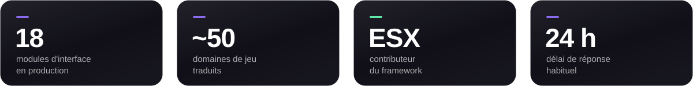
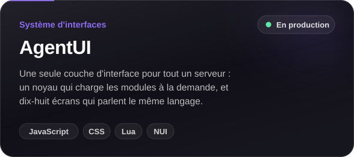
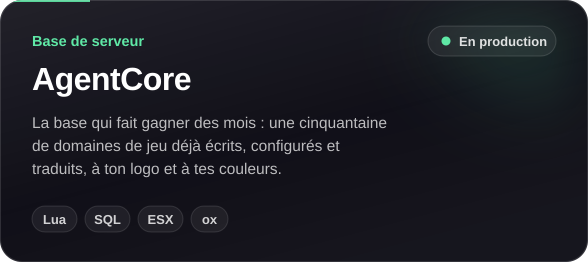
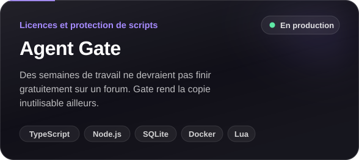
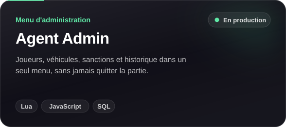

  

 

Je construis des bases de serveur FiveM, leurs interfaces en jeu et les outils qui vont avec. Contributeur du framework ESX.

- **Fini veut dire fini.** Un produit sort quand quelqu'un qui ne code pas peut l'installer et s'en servir seul.
- **La sécurité avant la sortie.** Un serveur qui tombe à cause d'un exploit perd sa communauté en une soirée.
- **Clair du premier coup.** Si une interface a besoin d'un mode d'emploi, c'est l'interface qu'il faut refaire.

 

## Travaux

Chaque carte ouvre l'étude de cas sur le [portfolio](https://astrowwww.github.io/projets.html).

## Compétences

## Open source

Je contribue à [esx-framework/esx_core](https://github.com/esx-framework/esx_core), le cœur du framework ESX.

## Contributions

<picture>
  <source media="(prefers-color-scheme: dark)" srcset="https://raw.githubusercontent.com/ASTROWwwW/ASTROWwwW/output/github-snake-dark.svg">
  <source media="(prefers-color-scheme: light)" srcset="https://raw.githubusercontent.com/ASTROWwwW/ASTROWwwW/output/github-snake.svg">
  
</picture>

