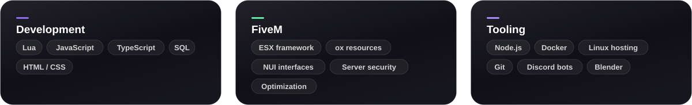

  

 

I build FiveM server bases, their in-game interfaces and the tools around them. ESX framework contributor.

## What I'm working on

Most of my recent work is private. In short:

- **FiveM:** server bases, ESX scripts and in-game interfaces
- **Roblox:** games
- **Tools and automation:** AI agents, Discord bots, content automation
- **Script protection and licensing,** plus the websites around them

## Skills

## Open source

I contribute to [esx-framework/esx_core](https://github.com/esx-framework/esx_core), the core of the ESX framework.

<picture>
  <source media="(prefers-color-scheme: dark)" srcset="https://raw.githubusercontent.com/ASTROWwwW/ASTROWwwW/output/github-snake-dark.svg">
  <source media="(prefers-color-scheme: light)" srcset="https://raw.githubusercontent.com/ASTROWwwW/ASTROWwwW/output/github-snake.svg">
  
</picture>

